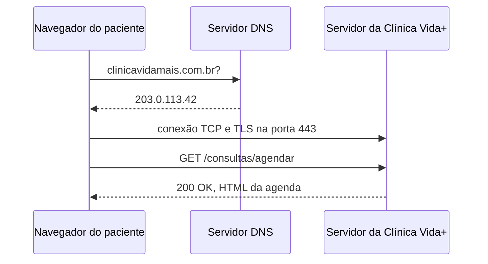

# Arquitetura da Requisição Web - Clínica Vida+

## O caminho de uma requisição



---

## Evidência do DNS

Saída dos comandos de resolução de nomes e teste de conectividade executados no terminal:

```text
miguel@mgs-core369:~$ nslookup github.com
Server:		127.0.0.53
Address:	127.0.0.53#53

Non-authoritative answer:
Name:	github.com
Address: 4.228.31.150

miguel@mgs-core369:~$ ping -c 4 github.com
PING github.com (4.228.31.150) 56(84) bytes of data.
64 bytes from 4.228.31.150: icmp_seq=1 ttl=116 time=8.57 ms
64 bytes from 4.228.31.150: icmp_seq=2 ttl=116 time=12.1 ms
64 bytes from 4.228.31.150: icmp_seq=3 ttl=116 time=13.4 ms
64 bytes from 4.228.31.150: icmp_seq=4 ttl=116 time=8.95 ms

--- github.com ping statistics ---
4 packets transmitted, 4 received, 0% packet loss, time 3005ms
rtt min/avg/max/mdev = 8.567/10.754/13.422/2.055 ms
```

---

## Evidência do HTTP

Registo de requisições recolhidas na aba Network do DevTools:

| Método | Recurso Pedido | Código de Status | Tipo de Conteúdo (Content-Type) |
| :--- | :--- | :--- | :--- |
| `GET` | `/` | `200 OK` | `text/html; charset=utf-8` |
| `GET` | `/assets/framework.css` | `200 OK` | `text/css` |
| `GET` | `/assets/app.js` | `200 OK` | `application/javascript` |
| `GET` | `/rota-inexistente` | `404 Not Found` | `text/html` |

---

## Justificativa para Uso de HTTPS no Formulário

A utilização do protocolo HTTPS no formulário de agendamento da Clínica Vida+ é indispensável para assegurar a confidencialidade e a integridade da comunicação entre o navegador do paciente e o servidor através de criptografia TLS. A aplicação processa dados altamente sensíveis, tais como CPF, histórico de saúde, sintomas relatados e especialidade médica pretendida. Sem essa camada de proteção criptografada, as informações trafegariam em texto simples na rede, ficando vulneráveis a interceptações indevidas (man-in-the-middle) e violando preceitos de privacidade e proteção de dados em ambientes clínicos.
